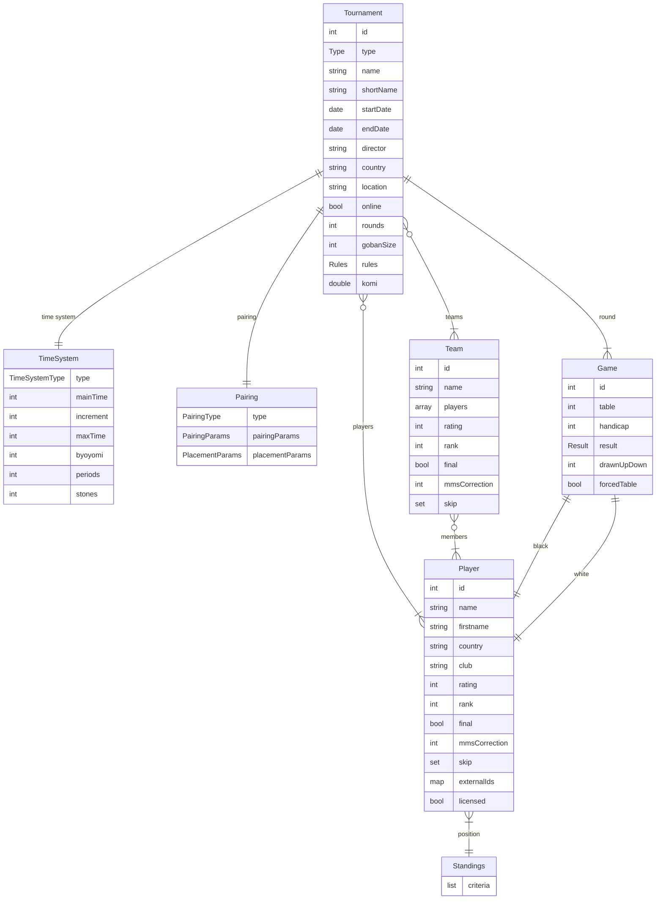

# Pairgoth Reference Documentation

[TOC]

This document defines pairgoth's data model (the fields of tournaments, players, teams, games and placement criteria, as stored in `.tour` files and exchanged through the API) and summarizes how pairgoth connects to an event website. For a walkthrough, see the [tutorial](tutorial); for pairing parameters, the [pairing documentation](pairing).

## Pairgoth model

*Entities and their relationships; each entity's full field list follows.*

### Entity relationship diagram

### Tournament

A tournament, individual or team. Its `type` (see below) decides how many players make up one pairable entrant.

| Field | Type | Description |
|-------|------|-------------|
| id | int | Tournament identifier |
| type | Type | Tournament format |
| name | string | Full tournament name |
| shortName | string | Abbreviated name |
| startDate | date | Start date |
| endDate | date | End date |
| director | string | Tournament director |
| country | string | Country code (default: "fr") |
| location | string | Venue location |
| online | bool | Online tournament |
| rounds | int | Total number of rounds |
| gobanSize | int | Board size (default: 19) |
| rules | Rules | Scoring rules |
| komi | double | Komi value (default: 7.5) |
| timeSystem | TimeSystem | Time control |
| pairing | Pairing | Pairing system |
| tablesExclusion | list | Table exclusion rules per round |

#### Tournament types

| Type | Players/Team | Description |
|------|--------------|-------------|
| INDIVIDUAL | 1 | Individual players |
| PAIRGO | 2 | Pair Go (alternating) |
| RENGO2 | 2 | Rengo with 2 players |
| RENGO3 | 3 | Rengo with 3 players |
| TEAM2 | 2 | Team with 2 boards |
| TEAM3 | 3 | Team with 3 boards |
| TEAM4 | 4 | Team with 4 boards |
| TEAM5 | 5 | Team with 5 boards |

#### Rules

- `AGA`: AGA rules
- `FRENCH`: French rules
- `JAPANESE`: Japanese rules
- `CHINESE`: Chinese rules

### Player

Individual tournament participant.

| Field | Type | Description |
|-------|------|-------------|
| id | int | Player identifier |
| name | string | Last name |
| firstname | string | First name |
| country | string | Country code |
| club | string | Club affiliation |
| rating | int | EGF-style rating |
| rank | int | Rank (-30 = 30k to 8 = 9d) |
| final | bool | Registration confirmed (*final*); false = *preliminary* |
| mmsCorrection | int | McMahon score correction |
| skip | set | Skipped round numbers |
| externalIds | map | External IDs (AGA, EGF, FFG, EXT) |
| licensed | bool | FFG licence up to date (FR snapshot); absent = unknown |
| previousOrder | int | API only, no UI: a hook for an external tie-break, the player's placement in a previous event or an external scoring (1 = best); used by the PREV criterion |

### Team

Team participant (for team tournaments).

| Field | Type | Description |
|-------|------|-------------|
| id | int | Team identifier |
| name | string | Team name |
| players | array | Member player IDs |
| rating | int | Computed from members |
| rank | int | Computed from members |
| final | bool | Computed from members: true when every member is *final* |
| mmsCorrection | int | McMahon score correction |
| skip | set | Skipped round numbers |
| previousOrder | int | API only, no UI: a hook for an external tie-break, the team's placement in a previous event or an external scoring (1 = best); used by the PREV criterion |

### Game

Single game in a round.

| Field | Type | Description |
|-------|------|-------------|
| id | int | Game identifier |
| table | int | Table number (0 = unpaired) |
| white | int | White player ID (0 = bye) |
| black | int | Black player ID (0 = bye) |
| handicap | int | Handicap stones |
| result | Result | Game outcome |
| drawnUpDown | int | Draw-up/draw-down (DUDD) marker, from white's side: 1 = white came from a stronger score group than black (white drawn down, black drawn up), -1 = the reverse, 0 = same group |
| forcedTable | bool | Table number set by hand |

#### Result

| Code | Description |
|------|-------------|
| ? | Unknown (not yet played) |
| w | White won |
| b | Black won |
| = | Jigo (draw) |
| X | Cancelled |
| # | Both win (unusual) |
| 0 | Both lose (unusual) |

### TimeSystem

Time control configuration.

| Field | Type | Description |
|-------|------|-------------|
| type | TimeSystemType | System type |
| mainTime | int | Main time in seconds |
| increment | int | Fischer increment in seconds |
| maxTime | int | Fischer maximum time in seconds |
| byoyomi | int | Byo-yomi time per period, in seconds |
| periods | int | Number of byo-yomi periods |
| stones | int | Stones per period (Canadian) |

#### TimeSystemType

| Type | Description |
|------|-------------|
| CANADIAN | Canadian byo-yomi |
| JAPANESE | Japanese byo-yomi |
| FISCHER | Fischer increment |
| SUDDEN_DEATH | No overtime |

### Pairing

Pairing systems and their parameters are documented in the [pairing documentation](pairing).

### Placement criteria

Criteria that order the standings. They are applied in sequence: each one only separates players tied on all the criteria before it.

#### Score-based

| Criterion | Description |
|-----------|-------------|
| NBW | Number of wins |
| MMS | McMahon score |
| STS | Strasbourg score. Not implemented: not offered in the UI, counts 0 in the standings |
| CPS | Cup score. Not implemented: not offered in the UI, counts 0 in the standings |
| SCOREX | Score X (congress score): in a McMahon tournament, the McMahon starting score plus the wins, without the points given for rounds not played; in a Swiss or French tournament, the main score (NBW, plus the group bonus for French) |
| BDW | Number of board wins, i.e. the sum of a team's board results over all rounds (team tournaments only; a jigo counts as half a win). The EGF recommends it as the first tie-break of a team tournament, and new team tournaments start with it. |

#### Opponent-based (W = wins, M = MMS)

| Criterion | Description |
|-----------|-------------|
| SOSW / SOSM | Sum of opponent scores |
| SOSWM1 / SOSMM1 | SOS ignoring the round of smallest value |
| SOSWM2 / SOSMM2 | SOS ignoring the two rounds of smallest value |
| SODOSW / SODOSM | Sum of defeated opponent scores |
| SOSOSW / SOSOSM | Sum of opponent SOS |
| CUSSW / CUSSM | Cumulative score sum |

#### Other

| Criterion | Description |
|-----------|-------------|
| CATEGORY | Player category. Not implemented: not offered in the UI, counts 0 in the standings |
| RANK | Player rank |
| RATING | Player rating |
| EGFDC | Direct comparison, EGF rules (see below) |
| DC | Direct confrontation (see below) |
| SDC | Simplified direct confrontation (see below) |
| PREV | Previous order: the entrants' relative order at an earlier time (a qualification, a previous event, an external scoring), 1 being the best, read from the `previousOrder` field. Set through the API only; there is no UI for it. Players with no recorded order rank behind those that have one. |
| LOTTERY | Drawing of lots, the EGF's last-resort tie-break. The lot is derived once from the player ID, so the standings never reshuffle between two computations. |
| EXT | Exploits attempted (OpenGotha's *exploits tentés*). Not implemented: not offered in the UI, counts 0 in the standings |
| EXR | Exploits successful (OpenGotha's *exploits réussis*). Not implemented: not offered in the UI, counts 0 in the standings |

#### Direct confrontation (EGFDC, DC and SDC)

The three criteria all order players that are tied on every criterion placed before them, using only the games those tied players played against each other. They differ in what they make of those games — **EGFDC** implements the European Go Federation's definition, DC and SDC reproduce OpenGotha's.

- **EGFDC** counts wins in the games played within the tied group; a jigo counts as half a win, and the total is rounded down, as the EGF does for all accumulated values in Swiss and McMahon tournaments, tie-breaks included. Handicap games count. The criterion applies only if all tied players played the *same number* of games against each other, as the EGF prescribes; otherwise the whole group scores 0. If players remain tied, EGFDC is applied again among them alone, which refines the first result rather than replacing it.
- **DC** ranks the tied group by "who beat whom", counting only even games with a plain win/loss result (when two players met several times their results are summed, so a 1-1 split cancels out). Victory cycles (A beats B, B beats C, C beats A) are neutralised: wins inside a cycle are ignored, and every member of the cycle inherits the cycle's collective wins and losses against the rest of the group, so beating one member of a cycle counts as beating them all. The group is then filled from the bottom: among the players left with no remaining victory, the ones ranked lowest by the criteria placed *after* DC go last. The DC number itself is only meaningful within the group (higher is better).
- **SDC** uses the same games as DC, and applies only when every pair of tied players has a decided result between them; each player then scores the number of tied opponents they beat. Otherwise everyone in the group scores 0.

The placement criteria may include at most one of EGFDC, DC and SDC, just as they may include at most one of SOS, SOS-1 and SOS-2 (SOSW/SOSM, SOSWM1/SOSMM1, SOSWM2/SOSMM2); the EGF is explicit on both points. Pairgoth rejects a criteria list that breaks this rule when you set it, but still opens an existing tournament that has one. EGFDC exists only in pairgoth: OpenGotha will not understand it in an exported file.

#### Setting the criteria

The **Standings** tab offers four criterion slots (**Crit #1**–**Crit #4**), applied in order; a slot left on NONE is ignored.

The criteria that order players **when pairing a round** may differ from those that order the standings. The EGF asks pairing programs to allow this, because SOS and its variants are reasonable for pairing but questionable for final standings. Set this second list under **Advanced parameters** › *Player ordering for pairing* (`pairingPlacement` in the API); if it is left all NONE, the standings criteria are used for pairing too.

### External databases

A player's `externalIds` map holds their identifiers in external rating databases:

| Database | Description |
|----------|-------------|
| AGA | American Go Association |
| EGF | European Go Federation |
| FFG | French Go Federation (FFG) |
| EXT | External registry configured by the event (see [technical](technical#external-registry-ext)) |

## Connecting to an event website

Pairgoth works on its own, but it can also connect to an event website (a club page, a federation site, or a large platform like the EGC). There are three typical setups, simplest first:

- **Publish from a laptop** (*local-publish*): you run pairgoth locally, publish pairings, results and standings to your event page with the **Publish to website** buttons, and can pull the roster with **Sync from website**. The only setup is the website's address and a shared secret.
- **Single hosted event** (*hosted-sesame*): pairgoth runs on a server and your event website drives it through the API (registers players, reads pairings, results and standings); access is protected by one shared password.
- **Multi-event platform** (*hosted-SSO-ACL*, EGC scale): the event website signs operators in and controls which tournaments each one can see. Only large multi-tournament platforms need this setup.

Configuration for each (addresses, secrets, single sign-on) is in the [technical documentation](technical#deployment-profiles).
